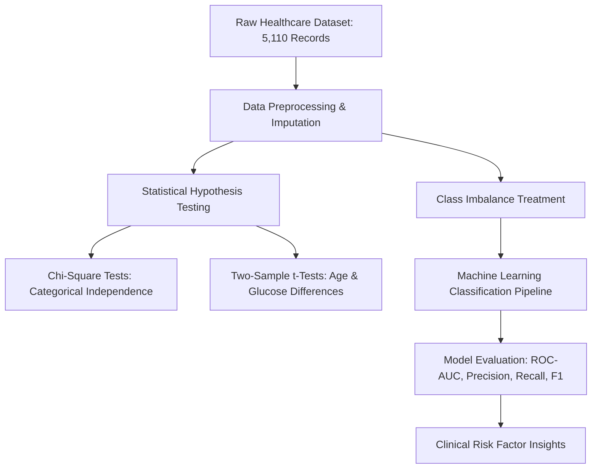

# Data-Driven Stroke Risk Analysis & Statistical Machine Learning

> **A Statistical Data Science (SDS) and predictive healthcare pipeline analyzing stroke indicators through clinical exploratory data analysis, hypothesis testing, and classification modeling.**

[](https://python.org)
[](https://scikit-learn.org)
[](https://www.statsmodels.org/)
[](https://jupyter.org)

---

## 1. Project Overview

Stroke is one of the leading global causes of mortality and long-term disability. Early identification of high-risk individuals can dramatically improve clinical outcomes and preventive care.

This project delivers an end-to-end **Statistical Data Science (SDS)** investigation on healthcare clinical data. It combines:
- **Exploratory Data Analysis (EDA):** Univariate, bivariate, and multivariate clinical distributions.
- **Rigorous Hypothesis Testing:** Two-sample t-tests, Chi-Square tests of independence ($\chi^2$), and normality assessments.
- **Predictive Machine Learning:** Data imputation, feature scaling, addressing severe clinical class imbalance, and training predictive classifiers evaluated via ROC-AUC and Precision-Recall metrics.

---

## 2. Clinical Dataset & Feature Schema

The dataset comprises **5,110 patient observations** evaluated across 11 key clinical and demographic attributes:

| Feature Name | Type | Description | Clinical Significance |
| :--- | :--- | :--- | :--- |
| `gender` | Categorical | Male, Female, Other | Demographic baseline |
| `age` | Numeric | Age of the patient in years | Primary physiological risk factor |
| `hypertension` | Binary (0/1) | Whether patient has high blood pressure | Vascular stress indicator |
| `heart_disease` | Binary (0/1) | Presence of existing cardiac condition | Circulatory impairment indicator |
| `ever_married` | Categorical | Yes / No | Socio-demographic proxy |
| `work_type` | Categorical | Private, Self-employed, Govt_job, children, Never_worked | Lifestyle and stress indicator |
| `Residence_type`| Categorical | Urban / Rural | Healthcare accessibility indicator |
| `avg_glucose_level` | Numeric | Average blood glucose level (mg/dL) | Diabetes / hyperglycemia biomarker |
| `bmi` | Numeric | Body Mass Index (kg/m²) | Obesity / metabolic biomarker |
| `smoking_status`| Categorical | formerly smoked, never smoked, smokes, Unknown | Cardiovascular risk factor |
| **`stroke`** *(Target)*| Binary (0/1) | Whether the patient experienced a stroke | Classification target |

---

## 3. Statistical Methodology & Workflow



### Statistical Hypotheses Evaluated:
1. **Hypertension & Stroke ($H_0$):** High blood pressure is independent of stroke occurrence.
   - *Result:* Rejected ($p < 0.001$). Strong statistically significant association.
2. **Glucose Level ($H_0$):** Mean average glucose level is identical between stroke and non-stroke patient cohorts.
   - *Result:* Rejected ($p < 0.001$, two-sample t-test). Elevated glucose significantly correlates with elevated risk.
3. **Age Gradient:** Age demonstrates the single strongest positive correlation with stroke probability.

---

## 4. Key Preprocessing & Engineering Steps

- **Handling Missing Values:** Imputed missing values in `bmi` using median strategy grouped by age brackets.
- **Categorical Encoding:** One-Hot Encoding and Label Encoding for nominal categories (`gender`, `work_type`, `smoking_status`).
- **Feature Scaling:** `StandardScaler` applied to continuous variables (`age`, `avg_glucose_level`, `bmi`).
- **Class Imbalance Mitigation:** Evaluated stratified sampling and cost-sensitive loss weighting to overcome severe positive-class sparsity (~4.9% positive stroke rate).

---

## 5. Technology Stack

- **Language:** Python 3.10+
- **Statistical Computing:** `scipy.stats` (norm, ttest_ind, chi2_contingency), `statsmodels`
- **Machine Learning:** `scikit-learn` (StandardScaler, train_test_split, LogisticRegression, classification_report, roc_auc_score)
- **Data Manipulation:** `pandas`, `numpy`
- **Data Visualization:** `matplotlib`, `seaborn`

---

## 6. Repository Structure

```
Stroke-Risk-Analysis-SDS-/
├── Healthcare_Stroke_Analysis(SDS)20 (1) (1).ipynb  # Master statistical data science notebook
└── README.md                                          # Project documentation
```

---

## 7. Setup & Execution

```bash
# 1. Clone repository
git clone https://github.com/keerthi19hub/Stroke-Risk-Analysis-SDS-.git
cd Stroke-Risk-Analysis-SDS-

# 2. Virtual environment
python -m venv venv
venv\Scripts\activate  # Windows
source venv/bin/activate  # Linux/macOS

# 3. Dependencies
pip install pandas numpy matplotlib seaborn scipy statsmodels scikit-learn jupyter

# 4. Launch notebook
jupyter notebook "Healthcare_Stroke_Analysis(SDS)20 (1) (1).ipynb"
```

---

## 8. Author & Academic Context

- **Author:** **Keerthi N** (*Alliance University, BCA*)
- **Academic Context:** Developed as an advanced project for **Statistical Data Science (SDS)**.
- **Verified Contribution:** Conducted full data audit, missing-value imputation, parametric and non-parametric hypothesis tests, machine learning models, and diagnostic visualization.

---

## 9. License

Released under the [MIT License](https://opensource.org/licenses/MIT).
